  <h1>Hey 👋, This is Aditi Singh</h1>
  
<b>A passionate Full Stack Developer · B.Tech CSE '27 · Open Source Contributor</b>

  

    
    
    
    
    
  

---

### 👩‍💻 About Me

B.Tech CSE undergraduate (`2023 – 2027`, **CGPA: 8.4 / 10** after 6th Sem; currently in 7th Sem) at **Uttaranchal University, Dehradun**, India, with strong foundations in **DSA**, **OOP**, **DBMS**, and **Operating Systems**. I build scalable full-stack web applications using **React.js**, **Node.js**, **Express.js**, **MongoDB**, **PostgreSQL**, **REST APIs**, and **JWT authentication**, alongside working knowledge of **Java** and **Spring Boot**.

- 🔭 **Currently Building:** **DevSync** *(Student Collaboration Platform)* & **yourCONTEST** *(College LMS & Contest Platform)*
- 🤝 **Open Source:** **GSSoC 2026** Selected Contributor with **3 merged pull requests** (`easemotion-css`, `internhack`)
- 🏆 **Hackathon:** **Top 10 Finalist** out of 100+ teams at **FAR AWAY 2026** (*Hope — Secure Exam OS*)
- 🧠 **Problem Solving:** **500+ LeetCode problems** solved across arrays, linked lists, stacks, queues, and trees
- 🎯 **Looking For:** **Full Stack Developer Intern** · **Software Engineering Intern** roles & impactful open-source collaborations

  

---

### 🛠️ Languages and Tools

**Languages** — `JavaScript (ES6+)` · `Java` · `SQL` · `HTML5` · `CSS3`
 

**Frameworks & Libraries** — `React.js` · `Node.js` · `Express.js` · `Spring Boot` *(working knowledge)* · `FastAPI` · `Vite`
 

**Databases** — `MongoDB` · `MySQL` · `PostgreSQL`
 

**Cloud & Deployment** — `Cloudflare` · `Vercel`
 

**Tools & OS** — `Git` · `GitHub` · `VS Code` · `Arch Linux`
 

**Core Concepts & Systems**
`REST APIs` · `JWT Authentication` · `OAuth` · `OOP` · `DSA` · `DBMS` · `Operating Systems (OS Basics)` · `ERP College-Email Auth` · `GTK4` · `PAM` · `GnuPG` · `ARIA Accessibility`

---

  <picture>
    <source media="(prefers-color-scheme: dark)" srcset="https://raw.githubusercontent.com/Aditisingh0102/Aditisingh0102/output/github-contribution-grid-snake-dark.svg" />
    <source media="(prefers-color-scheme: light)" srcset="https://raw.githubusercontent.com/Aditisingh0102/Aditisingh0102/output/github-contribution-grid-snake.svg" />
    
  </picture>

   

  

    
<b>✨ View More Live Workflow Stats (Pac-Man · Streak · Trophies)</b>

     
    <picture>
      <source media="(prefers-color-scheme: dark)" srcset="https://raw.githubusercontent.com/Aditisingh0102/Aditisingh0102/output/pacman-contribution-graph-dark.svg" />
      <source media="(prefers-color-scheme: light)" srcset="https://raw.githubusercontent.com/Aditisingh0102/Aditisingh0102/output/pacman-contribution-graph.svg" />
      
    </picture>
      
    
      
    
  

---

### 🌍 Open Source Contributions

- **GirlScript Summer of Code (GSSoC 2026) — Selected Contributor** *(May 2026 – Aug 2026)* · [GSSoC Profile](https://gssoc.girlscript.org/profile/)
  - Merged **3 pull requests** across active open-source repositories (`easemotion-css`, `internhack`).
  - Improved UI and accessibility by adding **animation utilities**, **ARIA labels**, and **hover/border effects**.

---

### 🎓 Education, Training & Certifications

- **B.Tech – Computer Science & Engineering** — *Uttaranchal University, Dehradun* (`2023 – 2027`) · **CGPA: 8.4 / 10** *(after 6th Sem; currently in 7th Sem)*
- **TCSiON Career Edge - Young Professional** — *Tata Consultancy Services* (`Jun 2025`)
- **Full Stack Development** — *Simplilearn* (`Aug 2025`)
- **Programming Using Java** — *Infosys Springboard* (`Jun 2025`)
- **Software Engineering Simulation** — *Accenture Nordics* (`Jun 2025`)

---

### 🏅 Achievements & Profiles

- 🧠 **500+ LeetCode Problems** solved across **arrays, linked lists, stacks, queues, and trees** — strengthening algorithmic thinking and problem-solving depth.
- 🥇 **Hackathon Finalist** — **Top 10 out of 100+ teams** at **FAR AWAY 2026** (*Hope* Secure Exam OS).
- 🌟 **GSSoC 2026** Selected Open Source Contributor.

  

    📧 <a href="mailto:aditii.singh0102@gmail.com">aditii.singh0102@gmail.com</a> &nbsp;·&nbsp;
    💼 <a href="https://www.linkedin.com/in/aditisingh0108">LinkedIn</a> &nbsp;·&nbsp;
    🧩 <a href="https://leetcode.com/Aditisingh_74/">LeetCode</a> &nbsp;·&nbsp;
    🐙 <a href="https://github.com/Aditisingh0102">GitHub</a>
  

  Always building, always learning · Uttaranchal University, Dehradun

